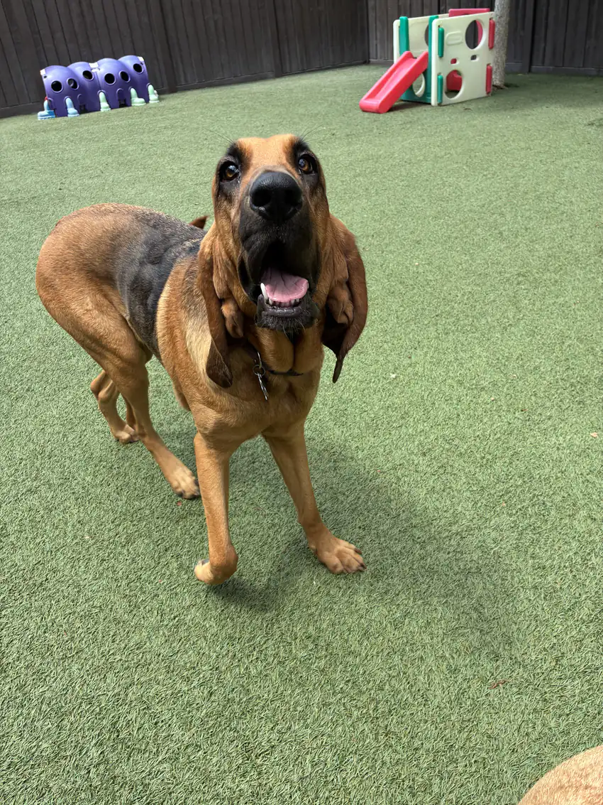

I'm Ryan. I build and run infrastructure - mostly Kubernetes and a home lab that refuses to stay simple - and I spend my days learning in public: open-source AI tooling, fleet automation, and a growing pile of Warhammer.

I became a dad this year, so the schedule is whatever the baby says it is. A bloodhound named Roxy handles quality control.

## What do I do?

Plenty, depending on the day.

Most of my hands-on time goes into **home-ops**, a Kubernetes and Terraform fleet I run for my own domains. It's the testbed for everything else: GitOps, storage, networking, backups, and the quiet work of keeping it all running.

The other thread is **open-source AI tooling** - how it fits into a home lab and into daily life. What actually helps, what looks great in a demo and falls over on contact, and what's worth handing to someone else. I learn it by building it, breaking it, and writing it down.

Underneath all of it is the same loop: build it, automate it, document it, then go find whatever breaks next.

If you want the résumé framing: Kubernetes engineer, with a long-running interest in storage, CNI, and automation.

## What am I into off the clock?

I rotate hobbies, but a few things have stuck.

**Warhammer 40,000** is the current constant. I'm well into the painting backlog everyone warned me about, and the grim darkness of the far future turns out to pair just fine with debugging clusters.

**3D printing** isn't running at the moment - the printer is dead - but I keep the mindset it gave me: the basics, elevated, beat clever solutions almost every time. That lesson outlived the hardware.

And then there's **Roxy**, a bloodhound who is excellent at reminding me to step away from the screen.

The common thread is tinkering: take something apart, understand how it works, and leave it a little better than you found it.

## How do I reach you?

Email is the best way to get to me: **rwaltr@rwalt.pro**. For everything else, the links on the homepage - GitHub, the token ring, and RSS. No forms, no scheduling links. If something here was useful, or you want to compare notes on home labs or AI tooling, say hello.

## What is this site?

I write here to think. Putting something into words is how I find out whether I actually understand it - and it's a lot cheaper than making the same mistake twice.

Some of it is infrastructure, some of it is whatever I'm painting or cooking. All of it is field notes.

Thanks for stopping by. The Emperor protects.
