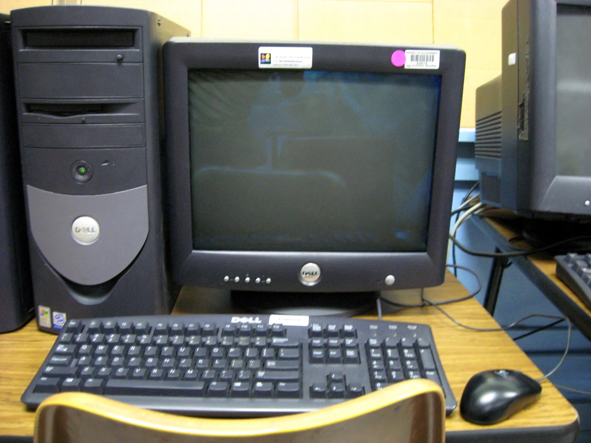
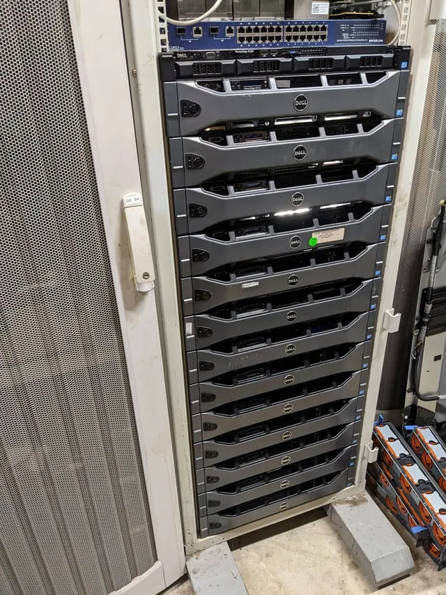
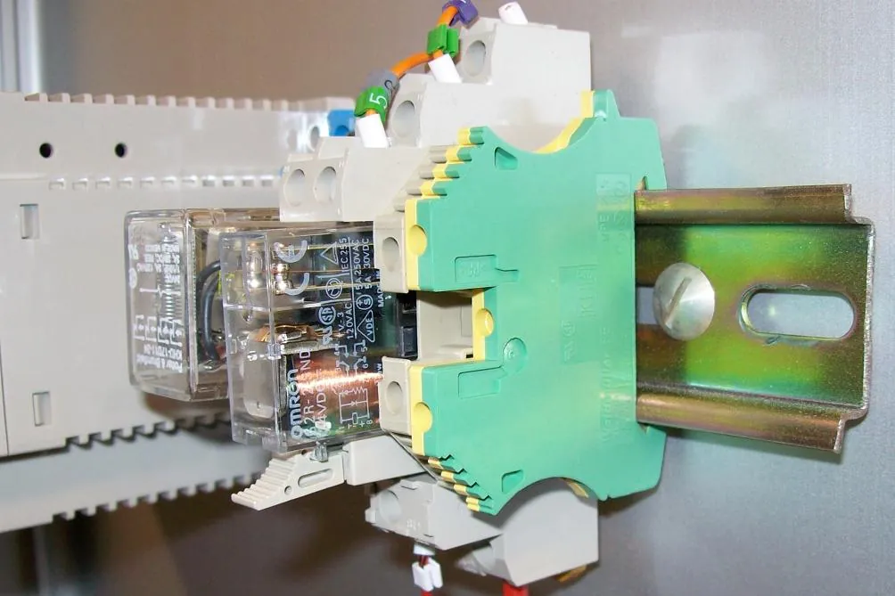
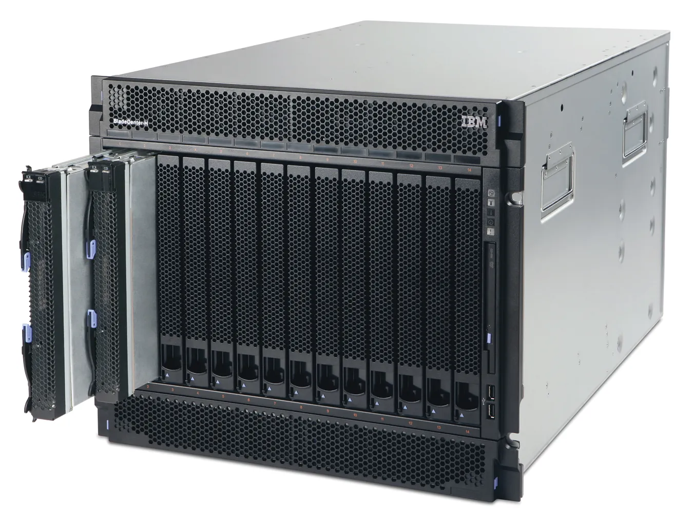
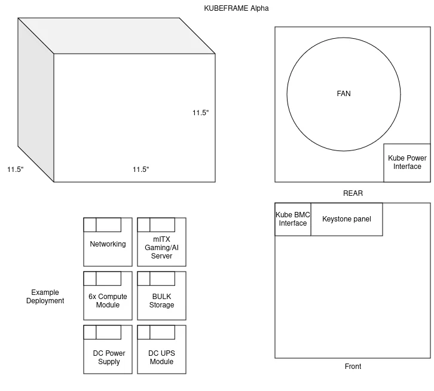

## Not all computers are in the same size
We have talked power in the past, (and more details are coming, I swear). But we have not talked about the physical size of computers in the homelab.

This can be a bit of a touchy subject, as the form factor of your computer is large dictated by the era you bought your computer, how powerful it is, and even its architecture.

Lets start with a history lesson, shall we?

### The early 2000s of home computing

Life was simple, You AOL'd your dial up with your netscape on yahoo. I think. 

In this age, Homelabbing was running your own ISP, BBS, or simple web server with maybe another desktop tower.

### The 2015 era of home computing

 
Source: https://www.reddit.com/r/homelab/comments/10e7dry/my_new_server_rack/

Ebay flows with surplus hardware, power is cheap, your wallet is thin, but the soul is willing. You just finished your ESXI Vmug purchase, and nothing can stop you and your 42U rack from computing perfection. 
Your life is ran by one standard, Rack units.

#### What even is a rack unit?
A rack unit is the height of a computer in a server rack, it is 1.75 inches, which is a bit thin.

Most devices in a server rack tend to be above 1u except for dedicated compute, or network switches, 2u is the minimum, 4u being the most common size for servers, both DIY and industrial

### The mid 2020s of home computing
> Holy COFLATION Batman!

Power cost has gone up, Raspi has died, and the mini-x86 revolution is in full swing!

We are trying to hold onto the glory of the 19in rack, but with some issues.

Most of the rackmount gear is made for intel nucs, a somewhat dying platform, and that gear is all over 50 USD, this still does not solve power density, or form how the ports on intel nucs are all over the place.

## What standards already exist for small device mounting?

There are a few preexisting sub computer mounting standards, surely we don't need to make another standard, right?

### DIN Rails
 
These are used in industrial settings, and are a bit of a pain to use, while the din rail itself is cheap, the actual computers and power supplies for this are expensive. This also limits you to small devices like SOCs and dedicated industrial computers. 
### Blade servers

 

Blade servers are typically vendor locked in vendor specific chassis, and are not very common in the homelab space, as they are expensive and power hungry, and have no interchangeability. 

### Open19's Bricks

 
If you remember from my first HomeCompute, I mentioned Open19, and their bricks. I think this has some merit, but the actual execution of this is difficult to execute in the home, due to their specialized dense cables. 

## It might be time to ditch the 19in rack.

A 19in rack only gives you about 17.5in or useable space for internal width, 17.5 x 3.5in x 25in is not optimized for your home space, you either have to sacrifice in additional upward Us, or a deeper rack. At that point, you wont be able to reach the back of your rack easily, and most of your space will be wasted.

If only there was some shape that is common and cheap enough for us to use and work with on a normal basis...

## The KubeLab

While preparing to move for what seems to be the 3rd failed time. My wife was about to throw out a offbrand cube shelf, similar to the Kallax from Ikea, and I had a thought.

> KUUUUUUBBEEEESSSSS

Naturally, the moment you think of something, someone else has as well, Like [this guy](https://www.youtube.com/watch?v=gEOYYCI55a4).

With the advent of 3d printers, custom bended and shaped metal services, and online 3d print catalog services, What if we could have a gridfinity for Homelabs?

### The Kube

 

Imagine, a frame with an ecosystem, you can mount dedicated modules in a standard furniture, make it look good doing it. I know its asking for a lot. But the juice may be worth the squeeze.

I still need to do a full cost analysis. But I think this is a good idea. 
